# TaskNest – Personal Task Management System

**Project Type:** Individual Micro Project
**Subject:** Full Stack Web Development using MERN
**Topic:** React Components, Event Handling and GraphQL API Integration

---

## 1. Project Title

**TaskNest – Personal Task Management System**

---

## 2. Introduction

TaskNest is a single-page web application that allows a user to maintain a personal list of tasks. The application is built on the MERN stack: a React.js frontend, a Node.js and Express.js backend, and a MongoDB database. Communication between the frontend and backend takes place through a GraphQL API, and the frontend issues every GraphQL request using the browser's native Fetch API.

The application supports five operations on tasks:

1. Adding a new task.
2. Displaying all stored tasks.
3. Editing the title of an existing task.
4. Marking a pending task as completed.
5. Deleting a task.

Each task consists of exactly three fields: `id`, `title` and `status`. The status of a task is either `Pending` or `Completed`.

The frontend is implemented entirely with React class components. It uses `constructor()`, `this.state`, `this.setState()`, `render()` and the `componentDidMount()` lifecycle method. It does not use React Hooks, Redux or Apollo Client. This keeps the underlying mechanisms of state management, props-based communication and GraphQL-over-HTTP explicit and easy to examine.

---

## 3. Project Objective

The objectives of developing TaskNest are as follows:

1. To develop a working task management system that demonstrates the design of **React class components**, including both stateful and stateless components.
2. To demonstrate **state management** using `this.state` and `this.setState()`, and initial data retrieval using the `componentDidMount()` lifecycle method.
3. To demonstrate **parent–child communication** through props, and **child-to-parent communication** through callback functions.
4. To apply the **Lifting State Up** pattern by keeping the task list in a single parent component.
5. To implement **React event handling** using the `onClick`, `onChange` and `onSubmit` events.
6. To design and implement a **GraphQL API** consisting of a type definition, one query, four mutations and their resolver functions.
7. To integrate the React frontend with the GraphQL API using the **native JavaScript Fetch API**.
8. To persist task records in a **MongoDB** database using a Node.js and Express.js backend written with CommonJS modules.

---

## 4. Problem Statement

Individuals routinely need to keep track of small, day-to-day tasks. Many available task management tools add features such as due dates, priorities, categories, reminders, analytics and multi-user collaboration. For a user who only needs to record a task, revise it, mark it as done and remove it, these features add complexity without proportional benefit.

A simple task management system with a minimal data model addresses this need directly. Each task needs only a title and a completion status. Such a system lets the user:

- record a task as soon as it arises,
- see all tasks and their status in one place,
- correct or refine a task title,
- distinguish clearly between pending and completed work, and
- remove tasks that are no longer relevant.

From an academic standpoint, the problem is also used to demonstrate core full-stack concepts. These are component-based UI design in React, event-driven state updates, a strongly typed GraphQL API and persistent storage in MongoDB. The project shows them without the abstraction introduced by higher-level client libraries.

---

## 5. Technologies Used

| Technology | Version (as used) | Purpose in TaskNest |
|---|---|---|
| **MongoDB** | MongoDB Community Server 9.0 (local) | Stores task documents in the `tasks` collection of the `tasknest_db` database. |
| **Mongoose** | ^8.9.5 | Object Data Modelling library used by the backend to define the `Task` schema and to query and update MongoDB. |
| **Express.js** | ^4.21.2 | HTTP server framework that hosts the GraphQL endpoint at `/graphql`, and applies the CORS and JSON body-parsing middleware. |
| **Node.js** | v24.21.0 | JavaScript runtime that executes the backend server. Backend files use CommonJS syntax (`require` / `module.exports`). |
| **GraphQL** | `graphql` ^16.10.0 with `@apollo/server` ^4.11.3 | Defines the API schema (type, query and mutations) and executes resolver functions. Apollo Server is used **only on the server side** as the GraphQL execution engine mounted on Express. |
| **React.js** | ^18.3.1 | Builds the user interface from four main class components: `TaskList`, `TaskAdd`, `TaskTable` and `TaskRow`. |
| **Vite** | ^6.0.7 | Development server and build tool for the React frontend. Serves the client on port 3000 and forwards (proxies) `/graphql` requests to the backend on port 5000. |
| **Fetch API** | Native browser API | Sends every GraphQL query and mutation as an HTTP `POST` request with a JSON body. No GraphQL client library is used. |
| **CSS** | CSS3 (`App.css`) | Provides the application's styling: colour scheme, cards, status badges, buttons, the empty-state message and responsive rules for small screens. |

**Supporting backend package:**

- `cors` (^2.8.5) enables Cross-Origin Resource Sharing on the Express server.

---

## 6. System Architecture

TaskNest follows a three-tier client–server architecture.

1. **Presentation tier (React frontend).** The browser loads the React application from the Vite development server (`http://localhost:3000`). The `TaskList` component holds the application state and sends GraphQL requests using `fetch()`.
2. **Application tier (Node.js, Express.js and GraphQL).** The Express server (`http://localhost:5000`) exposes a single GraphQL endpoint at `/graphql`. Apollo Server parses each incoming request, validates it against the schema defined in `typeDefs.js`, and invokes the corresponding resolver function from `resolvers.js`.
3. **Data tier (MongoDB).** Resolvers use the Mongoose `Task` model to read and write documents in the `tasks` collection of the `tasknest_db` database (`mongodb://127.0.0.1:27017/tasknest_db`).

**Communication path.** The frontend sends requests to the relative URL `/graphql`. During development, Vite's proxy (configured in `vite.config.js`) forwards these requests to `http://localhost:5000/graphql`. The Express server also enables CORS, so the endpoint can be called directly as well.

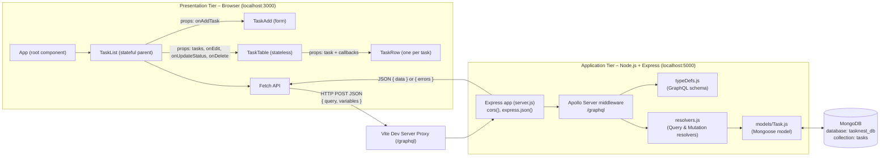

*Figure 6.1: System architecture of TaskNest.*

---

## 7. Project Folder Structure

```
TaskNet-mern/
│
├── client/                         # React frontend
│   ├── index.html                  # HTML page with the #root element; loads src/index.js
│   ├── vite.config.js              # Vite config: React plugin, port 3000, /graphql proxy
│   ├── package.json                # Frontend dependencies and scripts
│   └── src/
│       ├── index.js                # Entry point; mounts <App /> into #root
│       ├── App.jsx                 # Root class component; renders <TaskList />
│       ├── App.css                 # Application stylesheet
│       └── components/
│           ├── TaskList.jsx        # Stateful parent: task state + all GraphQL calls
│           ├── TaskAdd.jsx         # Add-task form (onChange / onSubmit)
│           ├── TaskTable.jsx       # Stateless table / empty-state renderer
│           └── TaskRow.jsx         # Single task row: Complete, Edit, Delete
│
├── server/                         # Node.js + Express backend
│   ├── server.js                   # Express app, Apollo Server, MongoDB connection
│   ├── package.json                # Backend dependencies and scripts
│   ├── models/
│   │   └── Task.js                 # Mongoose schema and model for tasks
│   └── schema/
│       ├── typeDefs.js             # GraphQL type definitions
│       └── resolvers.js            # GraphQL resolver functions
│
├── docs/
│   └── screenshots/                # Screenshots captured from the running application
│
├── package.json                    # Root project metadata
├── .gitignore
├── PROJECT_EXPLANATION.md          # Viva-oriented explanation document
└── PROJECT_DOCUMENTATION.md        # This document
```

**Purpose of important files**

| File | Purpose |
|---|---|
| `server/server.js` | Creates the Express application, starts Apollo Server with the schema and resolvers, registers the `/graphql` endpoint, connects to MongoDB and starts listening on port 5000. |
| `server/schema/typeDefs.js` | Declares the `Task` type, the `taskList` query and the four mutations in GraphQL Schema Definition Language. |
| `server/schema/resolvers.js` | Implements the logic behind each query and mutation using the Mongoose `Task` model. |
| `server/models/Task.js` | Defines the structure and validation rules of a task document. |
| `client/src/components/TaskList.jsx` | Main parent component. It holds the task list in state, performs all Fetch API calls and passes data and callbacks to its children. |
| `client/src/components/TaskAdd.jsx` | Captures the new task title and submits it to the parent. |
| `client/src/components/TaskTable.jsx` | Renders the task table, or an empty-state message when there are no tasks. |
| `client/src/components/TaskRow.jsx` | Renders one task, with inline editing and the Complete, Edit and Delete buttons. |
| `client/vite.config.js` | Runs the development server on port 3000 and proxies `/graphql` to `http://localhost:5000`. |

---

## 8. Component Design

### 8.1 Component Hierarchy

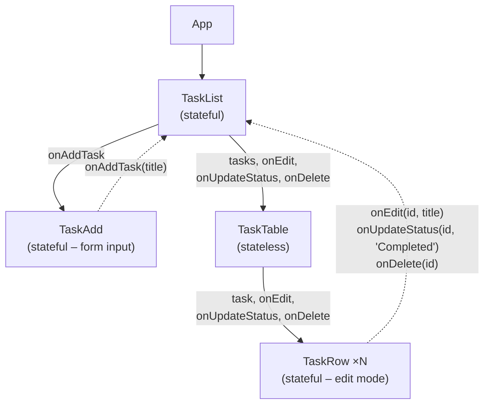

*Figure 8.1: Component hierarchy. Solid arrows show props flowing down; dashed arrows show callback invocations flowing up.*

The application entry point, `index.js`, mounts the root `App` class component. `App` renders only `<TaskList />`, wrapped in a container `div`.

### 8.2 Component Summary

| Component | Type | State | Props received | Callbacks invoked |
|---|---|---|---|---|
| `TaskList` | Stateful | `tasks`, `isLoading`, `alertMessage`, `alertType` | – | – |
| `TaskAdd` | Stateful | `title`, `inputError` | `onAddTask` | `onAddTask(title)` |
| `TaskTable` | Stateless | – | `tasks`, `onEdit`, `onUpdateStatus`, `onDelete` | – (forwards them) |
| `TaskRow` | Stateful | `isEditing`, `editTitle` | `task`, `onEdit`, `onUpdateStatus`, `onDelete` | `onEdit`, `onUpdateStatus`, `onDelete` |

### 8.3 TaskList

**Purpose.** `TaskList` is the main parent component and is the only component that communicates with the backend.

**Responsibilities.**

- Maintains the task list (`tasks`), a loading flag (`isLoading`) and a notification message (`alertMessage`, `alertType`) in its state.
- Retrieves all tasks when it first mounts, using the `taskList` query (`loadTasks()`).
- Implements four handler methods, each of which sends one GraphQL mutation:
  - `handleAddTask(title)`
  - `handleEditTask(id, newTitle)`
  - `handleUpdateStatus(id, newStatus)`
  - `handleDeleteTask(id)`
- Updates its state immutably after each successful response.
- Renders the header, the notification banner, three summary counters, the `TaskAdd` form and the `TaskTable`. The counters (Total, Pending and Completed) are calculated in `render()` from the `tasks` array; they are not stored as separate data.
- Displays success or error messages through `showAlert()`. Each message is cleared automatically after 3.5 seconds, or immediately when the user clicks the close (`×`) button (`clearAlert()`).

**Communication.** `TaskList` passes `handleAddTask` to `TaskAdd` as `onAddTask`. It passes `tasks` together with `handleEditTask`, `handleUpdateStatus` and `handleDeleteTask` to `TaskTable` as `onEdit`, `onUpdateStatus` and `onDelete`:

```jsx
<TaskAdd onAddTask={this.handleAddTask} />

<TaskTable
  tasks={tasks}
  onEdit={this.handleEditTask}
  onUpdateStatus={this.handleUpdateStatus}
  onDelete={this.handleDeleteTask}
/>
```

### 8.4 TaskAdd

**Purpose.** Provides the form used to enter and submit a new task title.

**Responsibilities.**

- Keeps the input value in its own state (`title`). This makes the input a *controlled component*.
- Updates `title` on every keystroke (`onChange`).
- On form submission (`onSubmit`), trims the title and checks that it is not empty. If it is empty, it sets `inputError`, and the message "Please enter a valid task title." is shown beneath the input, which is highlighted in red.
- For a valid title, calls the parent callback `this.props.onAddTask(trimmedTitle)` and clears the input field.

**Type.** Stateful, because it manages the form input. It holds no task data.

**Communication.** It receives `onAddTask` through props and invokes it to pass the new title up to `TaskList`.

### 8.5 TaskTable

**Purpose.** Displays the collection of tasks.

**Responsibilities.**

- Reads `tasks`, `onEdit`, `onUpdateStatus` and `onDelete` from `this.props`.
- If `tasks` is empty, renders an empty-state message: the heading "No Tasks Found" and the text "Your task list is empty. Add a task using the input field above to get started!".
- Otherwise, renders a table with the columns **ID**, **Task Title**, **Status** and **Actions**. It creates one `TaskRow` per task using `Array.prototype.map()`, with `task.id` as the React `key`.

**Type.** Stateless. It is written as a class component with only a `render()` method, and it does not declare `this.state`.

**Communication.** It acts as an intermediary: it passes each task object and the three callbacks unchanged to `TaskRow`.

```jsx
{tasks.map((task) => (
  <TaskRow
    key={task.id}
    task={task}
    onEdit={onEdit}
    onUpdateStatus={onUpdateStatus}
    onDelete={onDelete}
  />
))}
```

### 8.6 TaskRow

**Purpose.** Displays a single task and provides the controls that operate on it.

**Responsibilities.**

- Displays the task id (as `#id`), the title and a status badge. The badge is amber for `Pending` and green for `Completed`. The title of a completed task is shown in grey with a strike-through.
- Displays the **✓ Complete** button only while the task is `Pending`. The **✎ Edit** and **✕ Delete** buttons are always displayed in view mode.
- Manages an inline edit mode through local state (`isEditing`, `editTitle`). In edit mode, the title cell is replaced by a text input with **Save** and **Cancel** buttons, and the action buttons are hidden.
- Calls the parent callbacks to perform the actual operations:
  - `onEdit(id, title)`
  - `onUpdateStatus(id, 'Completed')`
  - `onDelete(id)`. Before this is called, the user must confirm a `window.confirm()` dialog.
- Uses `componentDidUpdate(prevProps)` to keep `editTitle` synchronised when the task title received through props changes.

**Type.** Stateful, but its state concerns only the presentation of the row (view mode or edit mode). The task data itself is always taken from `this.props.task`.

---

## 9. State Management

### 9.1 Constructor and `this.state`

Each stateful component initialises its state in the constructor after calling `super(props)`. Event-handler methods are bound to the component instance so that `this` refers to the component when the method is invoked from an event.

**`TaskList` constructor:**

```jsx
constructor(props) {
  super(props);
  this.state = {
    tasks: [],
    isLoading: true,
    alertMessage: null,
    alertType: 'info' // 'info', 'success', 'error'
  };

  // Method bindings
  this.loadTasks = this.loadTasks.bind(this);
  this.handleAddTask = this.handleAddTask.bind(this);
  this.handleEditTask = this.handleEditTask.bind(this);
  this.handleUpdateStatus = this.handleUpdateStatus.bind(this);
  this.handleDeleteTask = this.handleDeleteTask.bind(this);
  this.clearAlert = this.clearAlert.bind(this);
}
```

**`TaskRow` constructor:** the local state is initialised from props.

```jsx
this.state = {
  isEditing: false,
  editTitle: props.task.title
};
```

### 9.2 `componentDidMount()`

`componentDidMount()` runs once, immediately after `TaskList` has been inserted into the DOM. `TaskList` uses it to load the initial task list from the server:

```jsx
componentDidMount() {
  this.loadTasks();
}
```

While the request is in progress, `isLoading` is `true` and the text "Loading tasks..." is displayed next to the "Your Tasks" heading.

### 9.3 `this.setState()` and Immutable Updates

State is never assigned directly. Every change is made through `this.setState()`, which schedules a re-render of the component and its children. When the new state depends on the previous state, the functional form `this.setState(prevState => ...)` is used. Existing arrays are never modified in place; a new array is created for every change.

| Operation | Array method | Code in `TaskList` |
|---|---|---|
| Load | Replacement | `this.setState({ tasks: result.data.taskList \|\| [], isLoading: false })` |
| Add | `concat()` | `tasks: prevState.tasks.concat([newTask])` |
| Edit title / change status | `map()` | `tasks: prevState.tasks.map(task => task.id === updatedTask.id ? updatedTask : task)` |
| Delete | `filter()` | `tasks: prevState.tasks.filter(task => task.id !== id)` |

Because each call produces a new `tasks` array, React re-renders `TaskList`. The new array is then passed down to `TaskTable` and each `TaskRow`, and the summary counters are recalculated in `render()`. The visible interface therefore always reflects the latest state.

### 9.4 Lifting State Up

`TaskAdd`, `TaskTable` and `TaskRow` all depend on the same task data:

- `TaskAdd` creates tasks.
- `TaskTable` lists them.
- Each `TaskRow` modifies or removes one of them.

If any one of these components owned the list, the others could not see its changes. The task list is therefore **lifted up** to their closest common ancestor, `TaskList`. The children receive the data as props and request changes through callbacks. `TaskList` performs the change and updates the single shared copy of the state.

### 9.5 Parent–Child Communication Using Props and Callbacks

- **Downward (parent → child):** data and functions are passed as props, for example `tasks={tasks}` and `onDelete={this.handleDeleteTask}`.
- **Upward (child → parent):** a child calls a function it received as a prop, passing the required arguments.

```jsx
// TaskAdd.jsx – sending a new title to the parent
this.props.onAddTask(trimmedTitle);

// TaskRow.jsx – requesting operations on a task
this.props.onEdit(this.props.task.id, trimmedTitle);
this.props.onUpdateStatus(this.props.task.id, 'Completed');
this.props.onDelete(this.props.task.id);
```

---

## 10. Event Handling

React event handlers are attached as JSX attributes and refer to bound class methods. The following table lists every handler implemented in the application.

| Event | Element | Component | Handler method | Effect |
|---|---|---|---|---|
| `onChange` | New-task text input | `TaskAdd` | `handleInputChange` | Updates `title` and clears `inputError`. |
| `onSubmit` | Add-task form | `TaskAdd` | `handleSubmit` | Validates the title, calls `onAddTask`, then clears the input. |
| `onClick` | **✓ Complete** button | `TaskRow` | `handleCompleteClick` | Calls `onUpdateStatus(id, 'Completed')`. |
| `onClick` | **✎ Edit** button | `TaskRow` | `handleStartEdit` | Sets `isEditing: true` to show the inline editor. |
| `onChange` | Inline edit input | `TaskRow` | `handleTitleChange` | Updates `editTitle`. |
| `onClick` | **Save** button | `TaskRow` | `handleSaveEdit` | Validates the title, calls `onEdit(id, title)`, and leaves edit mode. |
| `onClick` | **Cancel** button | `TaskRow` | `handleCancelEdit` | Leaves edit mode and restores the original title. |
| `onClick` | **✕ Delete** button | `TaskRow` | `handleDeleteClick` | Asks for confirmation, then calls `onDelete(id)`. |
| `onClick` | Notification **×** button | `TaskList` | `clearAlert` | Hides the notification banner. |

### 10.1 `onChange`

```jsx
// TaskAdd.jsx
handleInputChange(event) {
  this.setState({
    title: event.target.value,
    inputError: ''
  });
}

<input
  type="text"
  className={`task-input ${inputError ? 'input-invalid' : ''}`}
  placeholder="What needs to be done? Enter task title..."
  value={title}
  onChange={this.handleInputChange}
/>
```

The input's `value` is bound to `this.state.title`. Each keystroke therefore triggers `setState()`, and the component re-renders with the updated value.

### 10.2 `onSubmit`

```jsx
// TaskAdd.jsx
handleSubmit(event) {
  event.preventDefault();
  const trimmedTitle = this.state.title.trim();

  if (!trimmedTitle) {
    this.setState({ inputError: 'Please enter a valid task title.' });
    return;
  }

  // Call parent callback passed via props
  this.props.onAddTask(trimmedTitle);

  // Reset input field after submission
  this.setState({
    title: '',
    inputError: ''
  });
}

<form className="task-add-form" onSubmit={this.handleSubmit}>
  ...
  <button type="submit" className="btn btn-add">
    <span className="btn-icon">+</span> Add Task
  </button>
</form>
```

`event.preventDefault()` stops the browser from performing a full page reload on submission. Because the button has `type="submit"`, the form is submitted both by clicking **Add Task** and by pressing the Enter key in the input field.

### 10.3 `onClick`

```jsx
// TaskRow.jsx
handleCompleteClick() {
  this.props.onUpdateStatus(this.props.task.id, 'Completed');
}

handleSaveEdit() {
  const trimmedTitle = this.state.editTitle.trim();
  if (!trimmedTitle) {
    alert('Task title cannot be empty.');
    return;
  }
  // Call parent callback
  this.props.onEdit(this.props.task.id, trimmedTitle);
  this.setState({ isEditing: false });
}

handleDeleteClick() {
  const confirmDelete = window.confirm(
    `Are you sure you want to delete task "${this.props.task.title}"?`
  );
  if (confirmDelete) {
    this.props.onDelete(this.props.task.id);
  }
}
```

In each case, the click handler in `TaskRow` does not modify any task data itself. It delegates the operation to `TaskList` through a callback. `TaskList` sends the GraphQL mutation and updates its state, and that state update re-renders the affected row.

---

## 11. GraphQL Schema

The schema is defined in `server/schema/typeDefs.js` using GraphQL Schema Definition Language (SDL):

```js
// GraphQL Type Definitions for TaskNest
const typeDefs = `#graphql
  type Task {
    id: Int!
    title: String!
    status: String!
  }

  type Query {
    taskList: [Task!]!
  }

  type Mutation {
    addTask(title: String!): Task!
    updateTask(id: Int!, title: String!): Task!
    updateTaskStatus(id: Int!, status: String!): Task!
    deleteTask(id: Int!): Boolean!
  }
`;

module.exports = typeDefs;
```

The exclamation mark (`!`) denotes a non-null type: the value must always be present.

### 11.1 `Task` Type

| Field | GraphQL type | Description |
|---|---|---|
| `id` | `Int!` | Unique integer identifier of the task, generated by the server. |
| `title` | `String!` | Text description of the task. |
| `status` | `String!` | Current state of the task: `"Pending"` or `"Completed"`. |

### 11.2 `Query` Type

| Field | Arguments | Return type | Description |
|---|---|---|---|
| `taskList` | – | `[Task!]!` | A non-null list of non-null `Task` objects, that is, all stored tasks. |

### 11.3 `Mutation` Type

| Field | Arguments | Return type | Description |
|---|---|---|---|
| `addTask` | `title: String!` | `Task!` | Creates a task and returns it. |
| `updateTask` | `id: Int!`, `title: String!` | `Task!` | Changes the title of a task and returns the updated task. |
| `updateTaskStatus` | `id: Int!`, `status: String!` | `Task!` | Changes the status of a task and returns the updated task. |
| `deleteTask` | `id: Int!` | `Boolean!` | Deletes a task. Returns `true` if a task was deleted, `false` otherwise. |

---

## 12. GraphQL Queries

The application implements one query.

### 12.1 `taskList`

| Item | Details |
|---|---|
| **Query name** | `taskList` (sent as the named operation `GetTaskList`) |
| **Purpose** | Retrieve every task stored in MongoDB, ordered by `id` in ascending order. |
| **Arguments** | None |
| **Used in** | `TaskList.loadTasks()`, which is called from `componentDidMount()` |

**GraphQL operation (from `TaskList.jsx`):**

```graphql
query GetTaskList {
  taskList {
    id
    title
    status
  }
}
```

**Expected response structure:**

```json
{
  "data": {
    "taskList": [
      { "id": 3, "title": "Build React Class Components and Event Handlers", "status": "Completed" },
      { "id": 4, "title": "Prepare MCA Project Viva Presentation", "status": "Completed" },
      { "id": 5, "title": "Complete Lab Task", "status": "Pending" }
    ]
  }
}
```

If the database contains no tasks, `taskList` is an empty array (`[]`), and `TaskTable` displays the empty-state message. If an error occurs, the response contains an `errors` array. The frontend then shows the message "Failed to load tasks: …" in the notification banner.

---

## 13. GraphQL Mutations

All four mutations are sent from `TaskList.jsx`. Each uses named GraphQL variables (for example `$title`), and the values are supplied separately in the `variables` object of the request body.

### 13.1 Add Task – `addTask`

| Item | Details |
|---|---|
| **Purpose** | Create a new task with the given title. The status is always set to `Pending`. |
| **Required arguments** | `title: String!` |
| **Returns** | The created `Task` (`id`, `title`, `status`) |
| **Frontend functionality** | `TaskAdd` form → `TaskList.handleAddTask(title)` |

```graphql
mutation AddNewTask($title: String!) {
  addTask(title: $title) {
    id
    title
    status
  }
}
```

Variables: `{ "title": "Prepare GraphQL Mutation Report" }`

Expected response:

```json
{ "data": { "addTask": { "id": 6, "title": "Prepare GraphQL Mutation Report", "status": "Pending" } } }
```

### 13.2 Update Task – `updateTask`

| Item | Details |
|---|---|
| **Purpose** | Change the title of an existing task. |
| **Required arguments** | `id: Int!`, `title: String!` |
| **Returns** | The updated `Task` |
| **Frontend functionality** | `TaskRow` **Save** button → `TaskList.handleEditTask(id, newTitle)` |

```graphql
mutation UpdateExistingTask($id: Int!, $title: String!) {
  updateTask(id: $id, title: $title) {
    id
    title
    status
  }
}
```

Variables: `{ "id": 6, "title": "Prepare GraphQL Mutation and Resolver Report" }`

Expected response:

```json
{ "data": { "updateTask": { "id": 6, "title": "Prepare GraphQL Mutation and Resolver Report", "status": "Pending" } } }
```

### 13.3 Update Task Status – `updateTaskStatus`

| Item | Details |
|---|---|
| **Purpose** | Change the status of an existing task. |
| **Required arguments** | `id: Int!`, `status: String!` (must be `"Pending"` or `"Completed"`) |
| **Returns** | The updated `Task` |
| **Frontend functionality** | `TaskRow` **✓ Complete** button → `TaskList.handleUpdateStatus(id, 'Completed')` |

```graphql
mutation UpdateStatus($id: Int!, $status: String!) {
  updateTaskStatus(id: $id, status: $status) {
    id
    title
    status
  }
}
```

Variables: `{ "id": 6, "status": "Completed" }`

Expected response:

```json
{ "data": { "updateTaskStatus": { "id": 6, "title": "Prepare GraphQL Mutation and Resolver Report", "status": "Completed" } } }
```

> **Note:** The resolver accepts both `Pending` and `Completed`. The user interface, however, only sends `Completed`, because its single status action is to mark a pending task as completed.

### 13.4 Delete Task – `deleteTask`

| Item | Details |
|---|---|
| **Purpose** | Permanently remove a task. |
| **Required arguments** | `id: Int!` |
| **Returns** | `Boolean!`: `true` if a task was deleted, `false` if no task had that id |
| **Frontend functionality** | `TaskRow` **✕ Delete** button (after confirmation) → `TaskList.handleDeleteTask(id)` |

```graphql
mutation RemoveTask($id: Int!) {
  deleteTask(id: $id)
}
```

Variables: `{ "id": 6 }`

Expected response:

```json
{ "data": { "deleteTask": true } }
```

Because `deleteTask` returns a scalar `Boolean`, the mutation has no selection set (no `{ ... }` after the field).

---

## 14. Resolver Functions

Resolvers are defined in `server/schema/resolvers.js` and exported as one object containing `Query` and `Mutation` maps. Apollo Server calls each resolver with the arguments `(parent, args)`. The first argument is not needed in this project and is named `_`. Required values are taken from `args` using object destructuring.

All resolvers are `async` functions that `await` Mongoose operations. Each is wrapped in `try...catch`: errors are logged on the server and re-thrown, and Apollo Server then returns them in the `errors` array of the GraphQL response.

### 14.1 `Query.taskList`

```js
taskList: async () => {
  try {
    const tasks = await Task.find({}).sort({ id: 1 });
    return tasks;
  } catch (error) {
    console.error('Error fetching tasks:', error);
    throw new Error('Failed to fetch tasks from database');
  }
}
```

- **Receives:** no arguments.
- **Operation:** `Task.find({})` retrieves every document; `.sort({ id: 1 })` orders them by `id` in ascending order.
- **Returns:** an array of task documents. GraphQL returns only the fields selected in the query (`id`, `title`, `status`).

### 14.2 `Mutation.addTask`

```js
addTask: async (_, { title }) => {
  try {
    if (!title || title.trim() === '') {
      throw new Error('Task title cannot be empty');
    }

    // Find the task with the highest id to determine the next id
    const lastTask = await Task.findOne().sort({ id: -1 });
    const nextId = lastTask && lastTask.id ? lastTask.id + 1 : 1;

    const newTask = new Task({
      id: nextId,
      title: title.trim(),
      status: 'Pending'
    });

    const savedTask = await newTask.save();
    return savedTask;
  } catch (error) {
    console.error('Error adding task:', error);
    throw new Error(error.message || 'Failed to add task');
  }
}
```

- **Receives:** `title`.
- **Operation:**
  1. Rejects empty titles.
  2. Finds the task with the highest `id` (`sort({ id: -1 })`) and calculates the next id as that value plus one, or `1` if the collection is empty.
  3. Creates and saves a new document with status `Pending`.
- **Returns:** the saved task.

### 14.3 `Mutation.updateTask`

```js
updateTask: async (_, { id, title }) => {
  try {
    if (!title || title.trim() === '') {
      throw new Error('Task title cannot be empty');
    }

    const updatedTask = await Task.findOneAndUpdate(
      { id: id },
      { title: title.trim() },
      { new: true }
    );

    if (!updatedTask) {
      throw new Error(`Task with id ${id} not found`);
    }

    return updatedTask;
  } catch (error) {
    console.error('Error updating task:', error);
    throw new Error(error.message || 'Failed to update task');
  }
}
```

- **Receives:** `id`, `title`.
- **Operation:** `findOneAndUpdate` locates the document whose `id` field matches and sets its `title`. The option `{ new: true }` makes Mongoose return the document *after* the update.
- **Returns:** the updated task. If no task matches, it throws an error.

### 14.4 `Mutation.updateTaskStatus`

```js
updateTaskStatus: async (_, { id, status }) => {
  try {
    if (!['Pending', 'Completed'].includes(status)) {
      throw new Error("Status must be either 'Pending' or 'Completed'");
    }

    const updatedTask = await Task.findOneAndUpdate(
      { id: id },
      { status: status },
      { new: true }
    );

    if (!updatedTask) {
      throw new Error(`Task with id ${id} not found`);
    }

    return updatedTask;
  } catch (error) {
    console.error('Error updating task status:', error);
    throw new Error(error.message || 'Failed to update task status');
  }
}
```

- **Receives:** `id`, `status`.
- **Operation:** checks that the status is one of the two permitted values, then updates the matching document.
- **Returns:** the updated task, or throws an error if the status is invalid or no task matches.

### 14.5 `Mutation.deleteTask`

```js
deleteTask: async (_, { id }) => {
  try {
    const result = await Task.findOneAndDelete({ id: id });
    if (!result) {
      return false;
    }
    return true;
  } catch (error) {
    console.error('Error deleting task:', error);
    throw new Error('Failed to delete task');
  }
}
```

- **Receives:** `id`.
- **Operation:** `findOneAndDelete` removes the matching document. It returns that document, or `null` if no document matched.
- **Returns:** `true` if a document was removed, otherwise `false`.

### 14.6 Server Wiring (`server.js`)

The schema and resolvers are combined into an Apollo Server instance, which is mounted on Express at `/graphql`. The Express server starts listening only after the MongoDB connection has succeeded:

```js
const apolloServer = new ApolloServer({
  typeDefs,
  resolvers,
});

await apolloServer.start();

app.use(cors());
app.use(express.json());
app.use('/graphql', expressMiddleware(apolloServer));

await mongoose.connect(MONGODB_URI);   // mongodb://127.0.0.1:27017/tasknest_db

app.listen(PORT, () => { ... });       // PORT = 5000
```

If the MongoDB connection fails, the error is logged and the process exits (`process.exit(1)`). The server also provides a simple `GET /` route that returns a JSON status message.

---

## 15. Fetch API Integration

### 15.1 Request Construction

Every GraphQL operation in `TaskList.jsx` follows the same five steps:

1. Define the query or mutation as a template string.
2. Call `fetch()` with the endpoint `GRAPHQL_ENDPOINT` (the constant `'/graphql'`) and the method `'POST'`.
3. Set the request header `'Content-Type': 'application/json'`.
4. Send a JSON body containing `query` and, for mutations, `variables`.
5. Parse the response with `response.json()`, check for `errors`, and update the state with `this.setState()`.

The add-task request below illustrates the complete pattern:

```jsx
handleAddTask(title) {
  const mutation = `
    mutation AddNewTask($title: String!) {
      addTask(title: $title) {
        id
        title
        status
      }
    }
  `;

  fetch(GRAPHQL_ENDPOINT, {
    method: 'POST',
    headers: {
      'Content-Type': 'application/json'
    },
    body: JSON.stringify({
      query: mutation,
      variables: { title }
    })
  })
    .then(response => response.json())
    .then(result => {
      if (result.errors && result.errors.length > 0) {
        throw new Error(result.errors[0].message);
      }

      const newTask = result.data.addTask;

      // Immutably append new task to state array using array concatenation
      this.setState(prevState => ({
        tasks: prevState.tasks.concat([newTask])
      }));

      this.showAlert(`Task "${newTask.title}" added successfully!`, 'success');
    })
    .catch(error => {
      console.error('Error adding task:', error);
      this.showAlert(`Failed to add task: ${error.message}`, 'error');
    });
}
```

### 15.2 HTTP Request and Response Format

The request actually sent over the network for the example above is:

```http
POST /graphql HTTP/1.1
Content-Type: application/json

{"query":"mutation AddNewTask($title: String!) { addTask(title: $title) { id title status } }",
 "variables":{"title":"Prepare GraphQL Mutation Report"}}
```

A GraphQL server always returns a JSON object with a `data` key, an `errors` key, or both. The frontend reads `result.data.<operationField>` on success. If `result.errors` is present, it throws an `Error`, which is handled in the `.catch()` block. Network failures, such as an unreachable server, also reach `.catch()`. In both cases a red error banner is displayed.

### 15.3 Mapping of Fetch Calls to State Updates

| Method | GraphQL field read | State update after success | Notification shown |
|---|---|---|---|
| `loadTasks()` | `result.data.taskList` | Replace `tasks`; `isLoading: false` | Only on failure |
| `handleAddTask()` | `result.data.addTask` | `concat` the new task | `Task "<title>" added successfully!` |
| `handleEditTask()` | `result.data.updateTask` | `map` – replace matching task | `Task #<id> updated successfully!` |
| `handleUpdateStatus()` | `result.data.updateTaskStatus` | `map` – replace matching task | `Task #<id> marked as Completed!` |
| `handleDeleteTask()` | `result.data.deleteTask` | `filter` – remove task (if `true`) | `Task #<id> deleted successfully.` |

The local state is updated only *after* the server confirms success. The interface therefore always reflects data that has actually been stored in MongoDB.

### 15.4 Development Proxy

The frontend uses a relative URL (`/graphql`). In development, Vite forwards this path to the backend, as configured in `client/vite.config.js`:

```js
server: {
  port: 3000,
  proxy: {
    '/graphql': {
      target: 'http://localhost:5000',
      changeOrigin: true
    }
  }
}
```

---

## 16. Database Design

### 16.1 Database and Collection

| Item | Value |
|---|---|
| Connection string | `mongodb://127.0.0.1:27017/tasknest_db` (can be overridden with the `MONGODB_URI` environment variable) |
| Database | `tasknest_db` |
| Collection | `tasks` (Mongoose's automatic plural of the model name `Task`) |

### 16.2 Mongoose Schema (`server/models/Task.js`)

```js
const taskSchema = new mongoose.Schema(
  {
    id: {
      type: Number,
      required: true,
      unique: true
    },
    title: {
      type: String,
      required: true,
      trim: true
    },
    status: {
      type: String,
      required: true,
      enum: ['Pending', 'Completed'],
      default: 'Pending'
    }
  },
  {
    versionKey: false // Exclude __v field
  }
);

const Task = mongoose.model('Task', taskSchema);
```

### 16.3 Field Description

| Field | Type | Constraints | Purpose |
|---|---|---|---|
| `_id` | ObjectId | Added automatically by MongoDB | Internal MongoDB primary key; not exposed through GraphQL. |
| `id` | Number | Required, unique | Application-level integer identifier used by the GraphQL API and the UI. |
| `title` | String | Required, trimmed | Task description. |
| `status` | String | Required; one of `Pending`, `Completed`; default `Pending` | Completion state of the task. |

The option `versionKey: false` prevents Mongoose from adding the `__v` version field. A stored document therefore contains only `_id` and the three task fields.

### 16.4 Representative Document

```json
{
  "_id": { "$oid": "<auto-generated ObjectId>" },
  "id": 5,
  "title": "Complete Lab Task",
  "status": "Pending"
}
```

### 16.5 Storage Operations

| Operation | Mongoose call (in resolvers) |
|---|---|
| Store | `new Task({ id, title, status: 'Pending' }).save()` |
| Retrieve | `Task.find({}).sort({ id: 1 })` |
| Determine next id | `Task.findOne().sort({ id: -1 })`, then highest `id` + 1 |
| Update title | `Task.findOneAndUpdate({ id }, { title }, { new: true })` |
| Update status | `Task.findOneAndUpdate({ id }, { status }, { new: true })` |
| Delete | `Task.findOneAndDelete({ id })` |

Because a new id is always the current highest id plus one, ids are not necessarily consecutive after deletions. If the task with the highest id is deleted, that id is assigned again to the next task that is created.

---

## 17. Application Functionalities

The common data flow for every operation is shown below and is then described for each functionality.

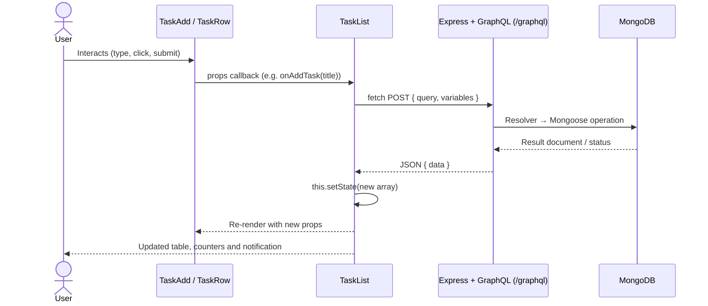

*Figure 17.1: General data flow from user interaction to database and back to the user interface.*

### 17.1 Adding a Task

1. The user types a title into the input field. `onChange` updates `TaskAdd.state.title`.
2. The user clicks **+ Add Task** or presses Enter. `onSubmit` invokes `handleSubmit()`, which prevents the page reload and validates the title.
3. `TaskAdd` calls `this.props.onAddTask(trimmedTitle)` and clears its input.
4. `TaskList.handleAddTask()` sends the `addTask` mutation.
5. The `addTask` resolver calculates the next id and saves a new document with status `Pending`.
6. The created task is returned. `TaskList` appends it to `tasks` using `concat()`.
7. The new row appears at the bottom of the table, the Total and Pending counters increase by one, and a green notification confirms the addition.

### 17.2 Displaying Tasks

1. When `TaskList` mounts, `componentDidMount()` calls `loadTasks()`, and "Loading tasks..." is displayed.
2. The `taskList` query is sent. The resolver returns all documents sorted by `id`.
3. `TaskList` stores the array in `tasks` and sets `isLoading` to `false`.
4. `TaskTable` renders one `TaskRow` per task. Each row shows the id, title and status badge. If there are no tasks, the empty-state message is displayed instead.
5. The summary counters show the total number of tasks and the numbers of pending and completed tasks.

### 17.3 Editing a Task

1. The user clicks **✎ Edit** on a row. `handleStartEdit()` sets `isEditing: true`, and the title cell becomes a text input pre-filled with the current title, alongside **Save** and **Cancel** buttons.
2. Typing in the input updates `editTitle` through `onChange`.
3. Clicking **Save** validates the title and calls `this.props.onEdit(id, trimmedTitle)`, and the row returns to view mode. Clicking **Cancel** instead discards the change.
4. `TaskList.handleEditTask()` sends the `updateTask` mutation. The resolver updates the document in MongoDB.
5. The updated task replaces the old one in `tasks` (using `map()`). The row displays the new title, and a notification confirms the update.

### 17.4 Marking a Task as Completed

1. On a row whose status is `Pending`, the user clicks **✓ Complete**.
2. `handleCompleteClick()` calls `this.props.onUpdateStatus(id, 'Completed')`.
3. `TaskList.handleUpdateStatus()` sends the `updateTaskStatus` mutation. The resolver validates the status and updates the document.
4. The returned task replaces the old one in `tasks`. On re-render:
   - the badge changes from amber **PENDING** to green **COMPLETED**,
   - the title is shown with a strike-through,
   - the **✓ Complete** button is no longer displayed for that row,
   - the Pending counter decreases and the Completed counter increases.
5. A notification "Task #id marked as Completed!" is shown.

### 17.5 Deleting a Task

1. The user clicks **✕ Delete** on a row.
2. `handleDeleteClick()` displays a browser confirmation dialog: *Are you sure you want to delete task "<title>"?*
3. If the user confirms, `this.props.onDelete(id)` is called. If the user cancels, nothing happens.
4. `TaskList.handleDeleteTask()` sends the `deleteTask` mutation. The resolver removes the document and returns `true`.
5. `TaskList` removes the task from `tasks` using `filter()`. The row disappears, the counters are updated, and the notification "Task #id deleted successfully." is shown.

---

## 18. Application Screenshots

All screenshots in this section were captured from the running application on 7 November 2026. The setup was: the backend on `http://localhost:5000`, connected to a local MongoDB 9.0 server, and the frontend on `http://localhost:3000`, viewed in Google Chrome. The interactions were performed through the actual user interface. After each operation, the database state was checked independently with a `taskList` query, which confirmed that:

- the task was created with `id: 6` and status `Pending`,
- its title was updated,
- its status changed to `Completed`, and
- it no longer existed after deletion.

The image files are stored in `docs/screenshots/`.

### Figure 18.1 – Main Application Interface

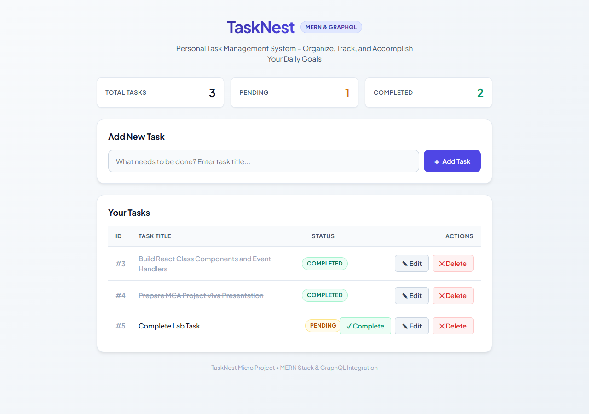

*Figure 18.1: Main interface of TaskNest showing the header, summary counters, the Add New Task form and the task table.*

The interface shows the application name with its subtitle, and three counters (Total Tasks, Pending, Completed). Below them are the task input with the **+ Add Task** button and the **Your Tasks** table. Completed tasks (#3 and #4) have a green badge and a struck-through title. The pending task (#5) has an amber badge and an additional **✓ Complete** button.

### Figure 18.2 – Adding a Task

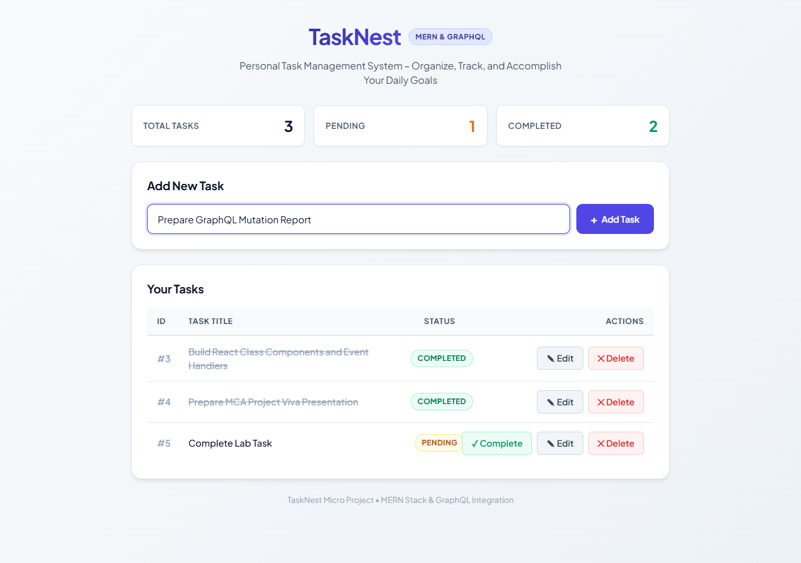

*Figure 18.2(a): A new task title entered in the input field of the TaskAdd component.*

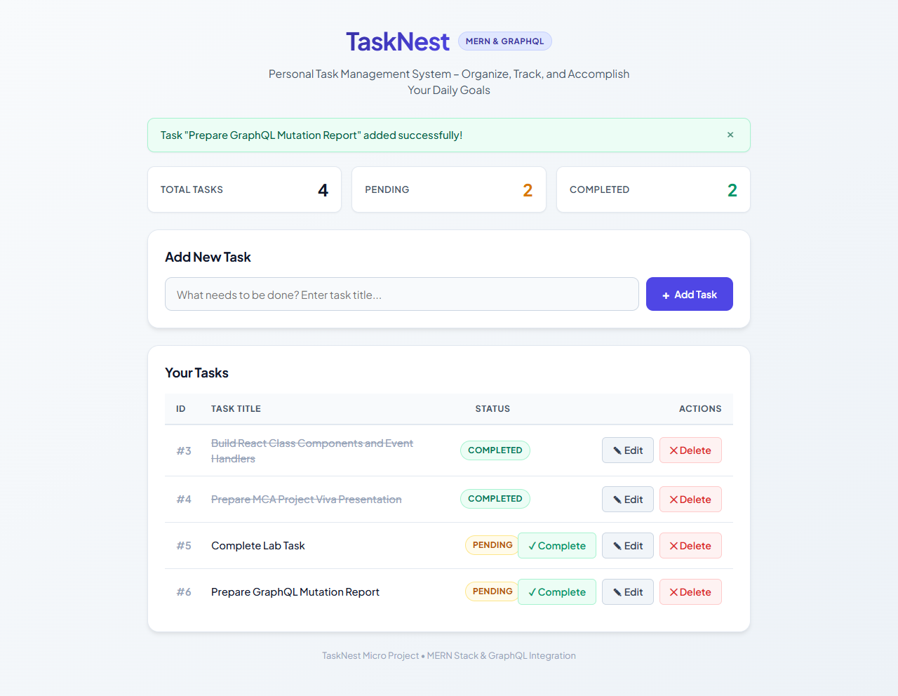

*Figure 18.2(b): The interface after the addTask mutation succeeded.*

After submission, the new task "Prepare GraphQL Mutation Report" appears as task #6 with status **PENDING**. The input field is cleared, the Total and Pending counters increase to 4 and 2, and a green notification confirms the addition.

### Figure 18.3 – Displaying Tasks

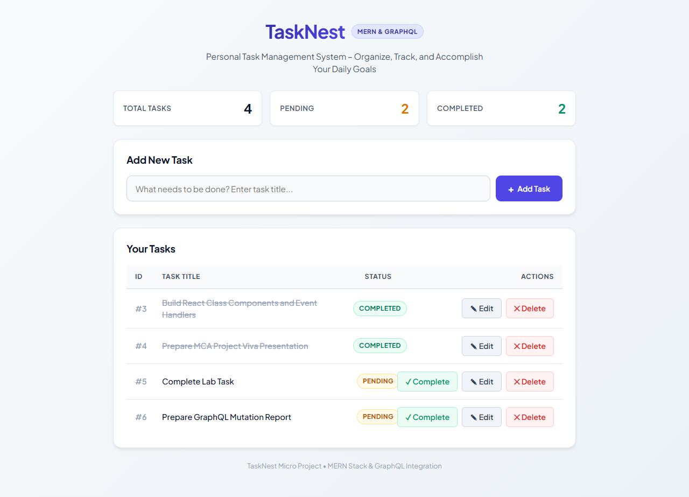

*Figure 18.3: The task list retrieved through the taskList query and rendered by TaskTable and TaskRow.*

Each row shows the task id, title, status badge and the available actions. The notification has been dismissed automatically after 3.5 seconds.

### Figure 18.4 – Editing a Task

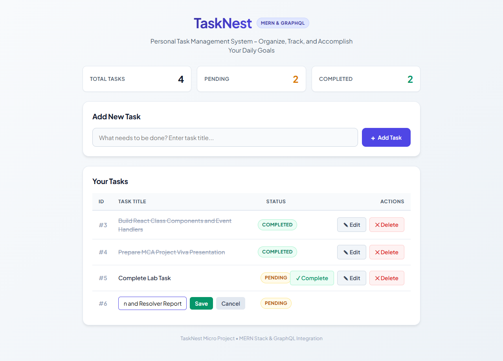

*Figure 18.4(a): Task #6 in inline edit mode, with the revised title entered and the Save and Cancel buttons.*

In edit mode, the title cell of task #6 is replaced by a text input with Save and Cancel buttons, and the row's action buttons are hidden. The table uses a fixed table layout with defined column dimensions (`col-id: 50px`, `col-status: 125px`, `col-actions: 280px`, `col-title: auto`) and `min-width: 0` on the input, ensuring that the inline editor comfortably fits within the task card boundaries without creating any horizontal overflow.

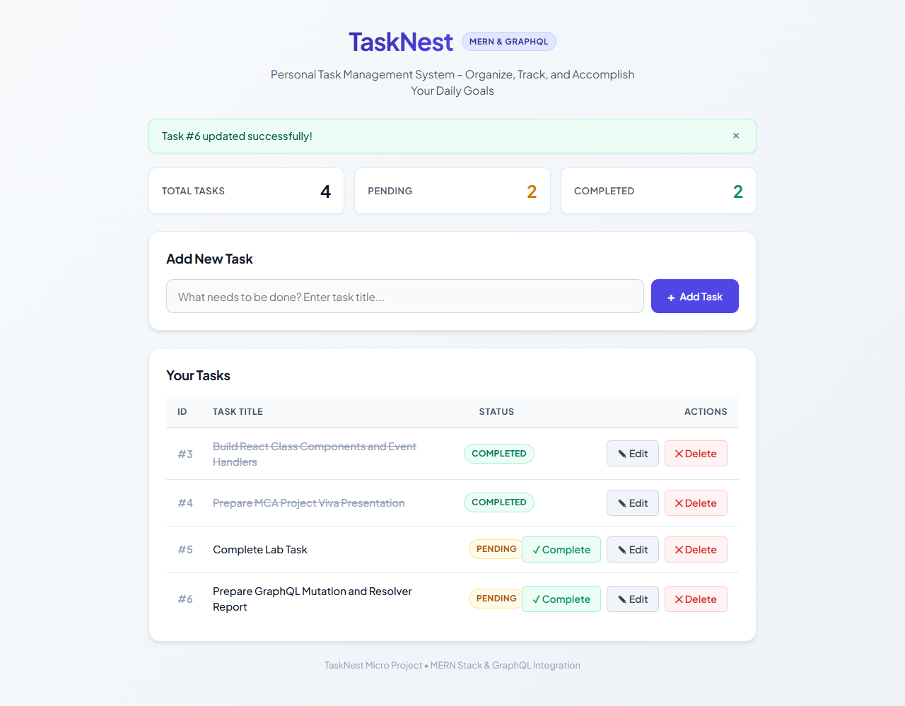

*Figure 18.4(b): Task #6 after the updateTask mutation, showing the new title "Prepare GraphQL Mutation and Resolver Report".*

### Figure 18.5 – Marking a Task as Completed

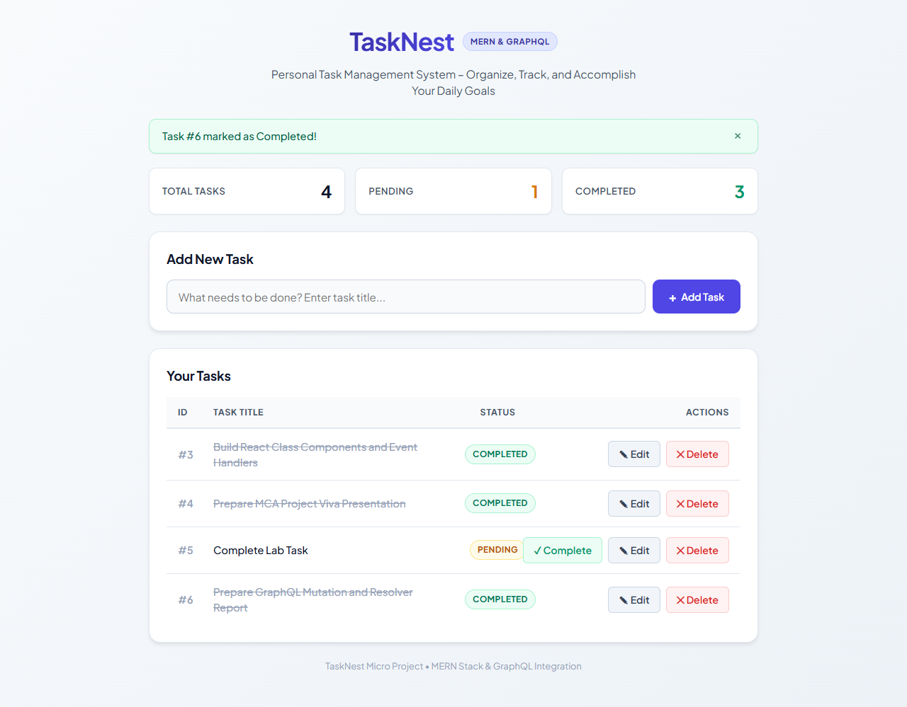

*Figure 18.5: Task #6 after the updateTaskStatus mutation.*

The badge of task #6 has changed to **COMPLETED**, its title is struck through, and the **✓ Complete** button has been removed from the row. The counters now show 1 pending and 3 completed tasks, and the notification reads "Task #6 marked as Completed!".

### Figure 18.6 – Deleting a Task

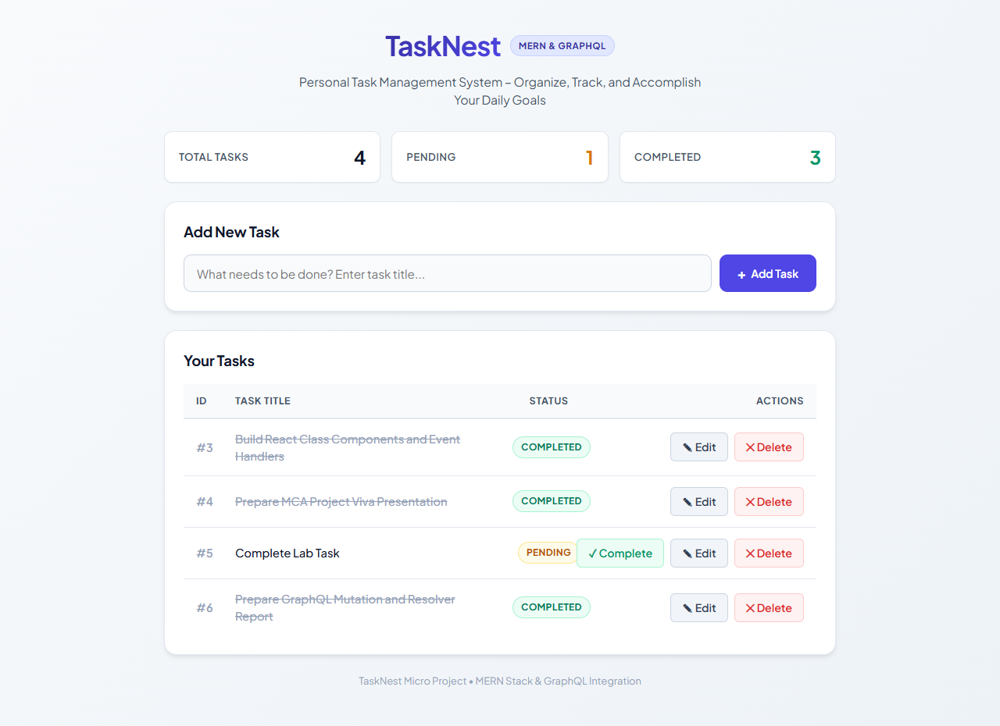

*Figure 18.6(a): The task list immediately before task #6 is deleted.*

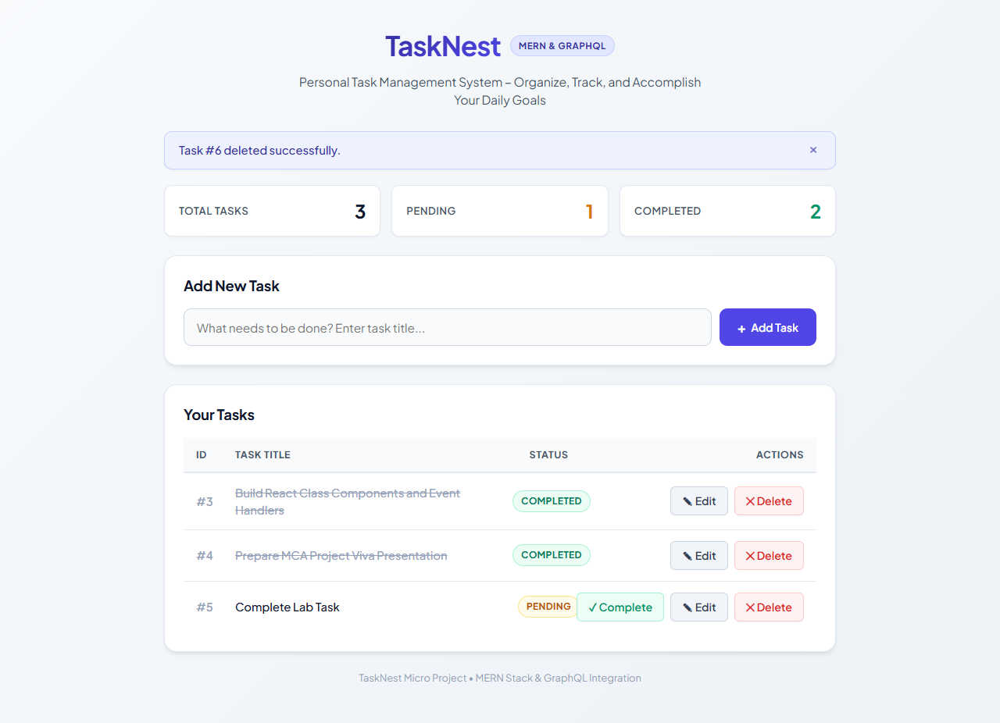

*Figure 18.6(b): The task list after the deleteTask mutation.*

After the user confirmed the dialog ("Are you sure you want to delete task "Prepare GraphQL Mutation and Resolver Report"?"), task #6 was removed from the table. The counters returned to 3 total, 1 pending and 2 completed, and the notification "Task #6 deleted successfully." is displayed.

> The browser confirmation dialog itself is drawn by the browser outside the page and therefore does not appear in the page screenshots. Its text, quoted above, was recorded during the test.

### Figure 18.7 – Layout on a Mobile-Width Screen

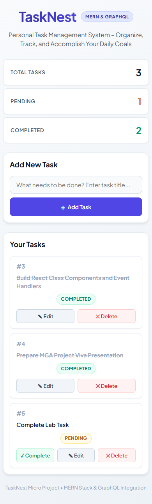

*Figure 18.7: TaskNest at a mobile viewport width of 390 pixels.*

On narrow screens, the responsive CSS media query (`max-width: 640px`) stacks the summary counters vertically, expands the **Add Task** button to full width beneath the input, and transforms the table into an ergonomic card-based list using CSS flexbox. Each card displays the task ID and title clearly at full readable width, with the status badge positioned beneath the title and the action buttons cleanly distributed side-by-side across the bottom. This eliminates horizontal scrolling and awkward text breaks on mobile devices.

> **Screenshot not captured – Empty state:** The empty-state message ("No Tasks Found") is implemented in `TaskTable`. It was not captured, because the database contained user tasks that were not deleted for documentation purposes. To capture it, open the application while the `tasks` collection is empty.

---

## 19. Conclusion

TaskNest has been implemented as a complete, working personal task management system on the MERN stack with a GraphQL API. The application allows tasks to be added, displayed, edited, marked as completed and deleted. Each operation was verified through the user interface and confirmed against the data stored in MongoDB.

The project demonstrates the following concepts:

- **React class components.** The project contains one stateless component (`TaskTable`) and three stateful components (`TaskList`, `TaskAdd`, `TaskRow`), built with `constructor()`, `this.state`, `this.setState()` and `render()`. Initial data is loaded in `componentDidMount()`.
- **Immutable state updates.** State changes use `concat()`, `map()` and `filter()`, so that every change produces a new array and triggers a re-render.
- **Props, callbacks and Lifting State Up.** The task list is held in `TaskList`, passed down as props, and modified only through callbacks invoked by child components.
- **React event handling.** The application handles `onChange`, `onSubmit` and `onClick` events for every user interaction.
- **GraphQL API design.** The API consists of a `Task` type, the `taskList` query, and the `addTask`, `updateTask`, `updateTaskStatus` and `deleteTask` mutations, each backed by a resolver function that uses Mongoose.
- **Native Fetch API integration.** The frontend sends GraphQL operations as JSON `POST` requests without any GraphQL client library.
- **MongoDB persistence.** Tasks are stored with a minimal schema of three fields: `id`, `title` and `status`.

The implementation stays within the defined scope of the micro project. It concentrates on the clear and correct application of React component design, event handling and GraphQL integration.

---

## Appendix A – Steps to Execute the Project

**Prerequisites:** Node.js (v18 or later), npm, and MongoDB Community Server running locally on port 27017.

1. Ensure the MongoDB service is running (Windows):
   ```powershell
   net start MongoDB
   ```
2. Start the backend:
   ```bash
   # From root:
   npm run server
   
   # Or directly from server folder:
   cd server
   npm install
   npm start
   ```
   Expected console output:
   ```
   Successfully connected to MongoDB database at: mongodb://127.0.0.1:27017/tasknest_db
   TaskNest Server is running on http://localhost:5000
   GraphQL endpoint available at http://localhost:5000/graphql
   ```
3. In a second terminal, start the frontend:
   ```bash
   # From root:
   npm run client
   
   # Or directly from client folder:
   cd client
   npm install
   npm run dev
   ```
4. Open `http://localhost:3000` in a web browser.

## Appendix B – Verification Summary

| # | Check | Result |
|---|---|---|
| 1 | Frontend starts (Vite on port 3000) | Verified |
| 2 | Backend starts (Express on port 5000) | Verified |
| 3 | MongoDB connection | Verified (connection message logged) |
| 4 | `taskList` query | Verified (directly and through the Vite proxy) |
| 5 | `addTask`, `updateTask`, `updateTaskStatus`, `deleteTask` mutations | Verified (directly and through the UI) |
| 6 | Fetch API communication from the React UI | Verified |
| 7–11 | Add, display, edit, complete, delete through the UI | Verified (Figures 18.1–18.6) with database state confirmed after each step |
| 12 | UI updates after every operation | Verified (table, counters and notifications) |

