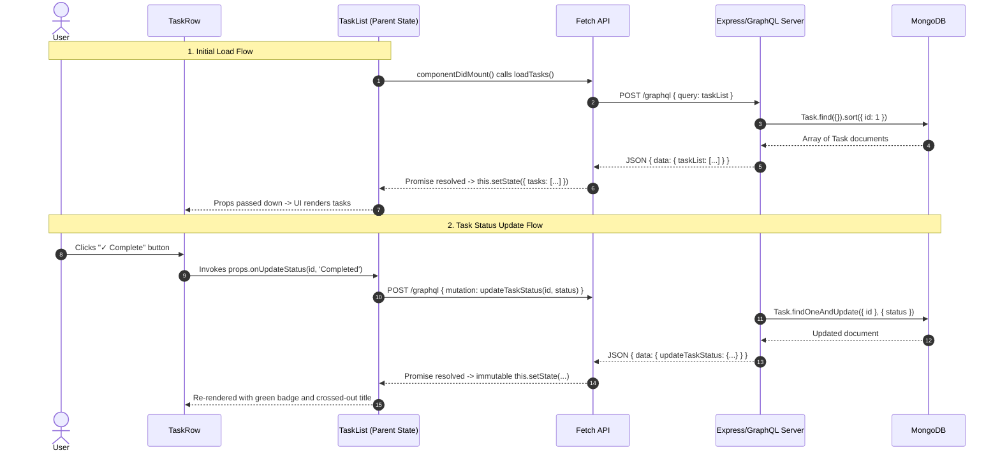

# TaskNest – Personal Task Management System
## Full Stack Web Development Micro Project (MERN & GraphQL)

---

## 1. Project Title
**TaskNest – Personal Task Management System**  
A full-stack, single-page micro application built using the MERN stack (MongoDB, Express.js, React.js, Node.js) with GraphQL API integration, developed specifically as an MCA academic project demonstrating React Class Components, Lifecycle Methods, Event Handling, Lifting State Up, and native Fetch API communication.

---

## 2. Project Objective
The primary objective of **TaskNest** is to design, implement, and document a fully functional Personal Task Management System that strictly adheres to foundational web engineering and React fundamentals:
- Demonstrate the design and operation of **React Class Components** utilizing constructors, `this.state`, and `this.setState()`.
- Use the **`componentDidMount()`** lifecycle method for asynchronous initial data fetching.
- Implement **Parent-Child Component Communication** through unidirectional data flow (`props`) and child-to-parent callback functions.
- Exemplify **Lifting State Up** by preserving all core application data in a centralized parent component (`TaskList`).
- Build a modular **Node.js + Express.js backend** running a **GraphQL API** with standard type definitions and resolvers.
- Persist structured records into **MongoDB** using Mongoose ODM.
- Integrate the frontend with the GraphQL backend using the **native JavaScript Fetch API** without third-party abstraction clients (such as Apollo Client or Redux).

---

## 3. Problem Statement
In individual productivity management, users frequently struggle with overly complicated tools loaded with redundant features (calendars, notifications, multi-level priorities, analytics) that introduce excessive friction. 

From an academic perspective, modern introductory full-stack projects frequently rely on complex state management libraries (Redux, Zustand) or high-level client caches (Apollo Client) that obscure the fundamental mechanisms of:
1. Component state mutation and reconciliation in React.
2. Unidirectional data passing via `props`.
3. The underlying HTTP payload format of GraphQL queries and mutations.

**TaskNest** resolves this by delivering a lightweight, intuitive, and distraction-free task tracker that adheres to strict constraints:
- Minimal task schema: only `id`, `title`, and `status`.
- Two deterministic status states: `Pending` and `Completed`.
- Direct, transparent HTTP `POST` communication via the native Fetch API.

---

## 4. Technologies Used

| Layer | Technology | Version / Specification | Role in Application |
|---|---|---|---|
| **Frontend UI** | React.js | 18.x | User interface constructed strictly with React Class Components. |
| **Frontend Tooling** | Vite | 6.x | Fast build tool and development server with reverse-proxy support. |
| **Styling** | Vanilla CSS | Custom CSS3 | Modern, responsive styling with CSS variables and flexbox/grid. |
| **Backend Runtime** | Node.js | v24.x (LTS compatible) | Server-side JavaScript execution environment. |
| **Backend Framework** | Express.js | 4.x | HTTP web server routing and middleware pipeline. |
| **API Specification** | GraphQL | 16.x / Apollo Server 4.x | Strongly-typed API schema, queries, and mutations. |
| **Database** | MongoDB | Community Server (v9.x/7.x) | NoSQL document database storing task records. |
| **Object Data Modeling** | Mongoose | 8.x | Schema validation and MongoDB document abstraction. |
| **API Communication** | Fetch API | Native Browser Standard | Sends GraphQL operations over HTTP `POST` requests. |
| **Module Syntax** | CommonJS (`require` / `module.exports`) | Backend Standard | Simple, traditional backend module management. |

---

## 5. Application Architecture

TaskNest follows a multi-tier, decoupled client-server architecture:

1. **Client Tier (Presentation Layer):**
   - Built with React Class Components.
   - Centralizes state management in `TaskList`.
   - Dispatches GraphQL operations across HTTP using the native browser `fetch()` API.
   - Re-renders interface elements immutably upon state updates.

2. **Middleware & Network Tier:**
   - Client requests are directed to the `/graphql` route.
   - Vite provides development reverse-proxying from port `3000` to port `5000`.
   - Express server enforces Cross-Origin Resource Sharing (`cors`) and parses JSON bodies (`express.json()`).

3. **API & Business Logic Tier (Application Layer):**
   - Apollo Server middleware mounted on Express handles GraphQL query and mutation requests.
   - Type definitions (`typeDefs.js`) declare the schema contracts.
   - Resolver functions (`resolvers.js`) execute business logic, input validation, and ID generation.

4. **Persistence Tier (Database Layer):**
   - MongoDB database (`tasknest_db`) running on localhost (`27017`).
   - Mongoose `Task` model stores only three defined properties: `id` (Number), `title` (String), and `status` (String).

---

## 6. Architecture Diagram

```mermaid
flowchart TD
    subgraph Client["Client Tier (React Frontend - Port 3000)"]
        UI["User Interface (DOM)"]
        App["App.jsx (Root Component)"]
        TaskList["TaskList.jsx (Stateful Parent Component)"]
        TaskAdd["TaskAdd.jsx (Input Form Component)"]
        TaskTable["TaskTable.jsx (Stateless Table View)"]
        TaskRow["TaskRow.jsx (Individual Row & Inline Edit)"]
        FetchAPI["Native JavaScript Fetch API"]

        UI <--> App
        App --> TaskList
        TaskList -->|Props: onAddTask| TaskAdd
        TaskList -->|Props: tasks, onEdit, onUpdateStatus, onDelete| TaskTable
        TaskTable -->|Props: task, callbacks| TaskRow
        TaskAdd -->|Callback: onAddTask(title)| TaskList
        TaskRow -->|Callbacks: onEdit, onUpdateStatus, onDelete| TaskList
        TaskList <-->|HTTP POST JSON (query/mutation)| FetchAPI
    end

    subgraph Server["Server Tier (Node.js & Express - Port 5000)"]
        Express["Express Server (server.js)"]
        Apollo["Apollo Server Middleware (/graphql)"]
        Schema["GraphQL Schema (typeDefs.js)"]
        Resolvers["GraphQL Resolvers (resolvers.js)"]

        Express --> Apollo
        Apollo --> Schema
        Apollo --> Resolvers
    end

    subgraph Database["Database Tier (MongoDB)"]
        Mongoose["Mongoose ODM (models/Task.js)"]
        MongoInstance[("MongoDB: tasknest_db\nCollection: tasks")]

        Resolvers <--> Mongoose
        Mongoose <--> MongoInstance
    end

    FetchAPI <==>|POST /graphql| Express
```

---

## 7. Project Folder Structure

```
TaskNet-mern/
│
├── client/
│   ├── src/
│   │   ├── components/
│   │   │   ├── TaskList.jsx    # Stateful parent: holds tasks state & API methods
│   │   │   ├── TaskAdd.jsx     # Stateful form component: adds new tasks
│   │   │   ├── TaskTable.jsx   # Stateless table component: renders task list
│   │   │   └── TaskRow.jsx     # Stateful row component: displays task & inline edit
│   │   │
│   │   ├── App.jsx             # Root Class Component
│   │   ├── index.js            # Entry point initializing ReactDOM root
│   │   └── App.css             # Complete application styles and responsive rules
│   │
│   ├── index.html              # HTML shell loading Google Fonts and index.js
│   ├── vite.config.js          # Vite config with React plugin and /graphql proxy
│   └── package.json            # Frontend dependencies and dev scripts
│
├── server/
│   ├── models/
│   │   └── Task.js             # Mongoose schema: id (Number), title, status
│   │
│   ├── schema/
│   │   ├── typeDefs.js         # GraphQL type declarations (Task, Query, Mutation)
│   │   └── resolvers.js        # GraphQL resolvers querying/mutating MongoDB
│   │
│   ├── server.js               # Express server setup, MongoDB connection & Apollo Server
│   └── package.json            # Backend dependencies and startup scripts
│
├── .gitignore                  # Git ignore rules for node_modules, logs, dist
├── package.json                # Root package.json for project orchestration
└── PROJECT_EXPLANATION.md       # Comprehensive MCA Viva & Academic Documentation
```

---

## 8. Application Workflow

The lifecycle of user actions follows a transparent and predictable sequence:



---

## 9. Explanation of Each React Component

### A. `TaskList.jsx` (Main Parent Component)
- **Role:** Central orchestrator of the entire application.
- **Responsibilities:**
  - Maintains `this.state.tasks`, `this.state.isLoading`, and `this.state.alertMessage`.
  - Executes all GraphQL queries and mutations via the native `fetch()` API.
  - Passes tasks data and callback handlers (`handleAddTask`, `handleEditTask`, `handleUpdateStatus`, `handleDeleteTask`) down to child components.
  - Immutably applies state updates using JavaScript array methods (`concat`, `map`, `filter`).

### B. `TaskAdd.jsx` (Input Form Component)
- **Role:** Handles creation of new tasks.
- **Responsibilities:**
  - Holds local form state: `title` and `inputError`.
  - Listens to user typing through `onChange` (`handleInputChange`).
  - Listens to form submission through `onSubmit` (`handleSubmit`).
  - Validates that title is not blank, triggers `this.props.onAddTask(title)`, and clears the input field.

### C. `TaskTable.jsx` (Display Table Component)
- **Role:** Presentational container for the task collection.
- **Responsibilities:**
  - Stateless class component receiving `tasks`, `onEdit`, `onUpdateStatus`, and `onDelete` strictly via `this.props`.
  - Checks if `tasks.length === 0`: renders a user-friendly empty state screen with an icon and guidance.
  - If tasks exist, maps over the array and renders an individual `<TaskRow />` for each task.

### D. `TaskRow.jsx` (Individual Task Row Component)
- **Role:** Displays single task details and controls inline editing and operations.
- **Responsibilities:**
  - Holds local state for inline editing: `isEditing` (boolean) and `editTitle` (string).
  - Displays ID (`#1`), task title, and styled status badge (`Pending` or `Completed`).
  - In view mode: renders "✓ Complete" (if Pending), "✎ Edit", and "✕ Delete" buttons.
  - In edit mode: renders an inline text box with "Save" and "Cancel" buttons.
  - Invokes parent callback functions passed down via props.

### E. `App.jsx` (Root Component)
- **Role:** Top-level application shell.
- **Responsibilities:**
  - Renders `<TaskList />` within an application container wrapper.

---

## 10. Stateful and Stateless Components

In React, distinguishing between stateful and stateless components is a fundamental design principle:

| Component | Type | State Held | Justification |
|---|---|---|---|
| **`TaskList`** | **Stateful** | `tasks`, `isLoading`, `alertMessage`, `alertType` | Must manage the shared application task records and network responses. |
| **`TaskAdd`** | **Stateful** | `title`, `inputError` | Needs controlled form input handling before submitting to parent. |
| **`TaskTable`** | **Stateless** | *None* (`this.state` is not declared) | Pure presentational component that solely renders UI based on `this.props`. |
| **`TaskRow`** | **Stateful** | `isEditing`, `editTitle` | Manages local UI mode (view vs inline editing) without polluting parent state. |

---

## 11. State Management using `this.state` and `this.setState()`

React Class Components initialize state in the `constructor(props)` and modify state exclusively via `this.setState()`. 

### State Initialization in `TaskList`:
```javascript
class TaskList extends React.Component {
  constructor(props) {
    super(props);
    this.state = {
      tasks: [],
      isLoading: true,
      alertMessage: null,
      alertType: 'info'
    };

    // Binding methods so 'this' references the component instance
    this.loadTasks = this.loadTasks.bind(this);
    this.handleAddTask = this.handleAddTask.bind(this);
    this.handleEditTask = this.handleEditTask.bind(this);
    this.handleUpdateStatus = this.handleUpdateStatus.bind(this);
    this.handleDeleteTask = this.handleDeleteTask.bind(this);
  }
  // ...
}
```

### Immutable State Modification
React state should never be modified directly (e.g. `this.state.tasks.push(newTask)` is prohibited because it does not trigger a re-render and violates immutability). 

In TaskNest, state updates create brand-new array references:
- **Adding a task (`concat`):**
  ```javascript
  this.setState(prevState => ({
    tasks: prevState.tasks.concat([newTask])
  }));
  ```
- **Updating a task or status (`map`):**
  ```javascript
  this.setState(prevState => ({
    tasks: prevState.tasks.map(task =>
      task.id === updatedTask.id ? updatedTask : task
    )
  }));
  ```
- **Deleting a task (`filter`):**
  ```javascript
  this.setState(prevState => ({
    tasks: prevState.tasks.filter(task => task.id !== id)
  }));
  ```

---

## 12. Props and Parent-Child Communication

In React, **props** (properties) allow data to flow unidirectionally from parent components to child components:

### Downward Flow (Parent to Child):
`TaskList` renders `TaskTable`, passing tasks array and functions as props:
```jsx
<TaskTable
  tasks={this.state.tasks}
  onEdit={this.handleEditTask}
  onUpdateStatus={this.handleUpdateStatus}
  onDelete={this.handleDeleteTask}
/>
```

`TaskTable` receives them and forwards them to `TaskRow`:
```jsx
<TaskRow
  key={task.id}
  task={task}
  onEdit={onEdit}
  onUpdateStatus={onUpdateStatus}
  onDelete={onDelete}
/>
```

Inside `TaskRow`, data is accessed as `this.props.task.title`, `this.props.task.status`, etc.

---

## 13. Lifting State Up

When multiple components need access to the same mutable data, the state is **lifted up** to their closest common ancestor:

- If `TaskAdd` kept the task list, `TaskTable` could not display it.
- If `TaskRow` kept the task list, other rows could not see new tasks.
- Therefore, the task list state is **lifted up to `TaskList`**.
- Child components receive **callback functions** as props (`onAddTask`, `onEdit`, `onUpdateStatus`, `onDelete`).
- When a child needs to modify data, it invokes the callback:
  ```javascript
  // In TaskAdd:
  this.props.onAddTask(trimmedTitle);

  // In TaskRow:
  this.props.onUpdateStatus(this.props.task.id, 'Completed');
  ```
- This triggers the parent method, executes the backend GraphQL mutation, updates the parent's `this.state`, and automatically updates the entire component tree.

---

## 14. React Event Handling

TaskNest uses standard synthetic event handlers bound to class methods:

### 1. `onChange` – Controlled Form Input
In `TaskAdd.jsx`:
```javascript
handleInputChange(event) {
  this.setState({
    title: event.target.value,
    inputError: ''
  });
}
// Render:
<input type="text" value={this.state.title} onChange={this.handleInputChange} />
```

### 2. `onSubmit` – Form Submission
In `TaskAdd.jsx`:
```javascript
handleSubmit(event) {
  event.preventDefault(); // Prevents full page reload
  if (!this.state.title.trim()) {
    this.setState({ inputError: 'Please enter a valid task title.' });
    return;
  }
  this.props.onAddTask(this.state.title.trim());
  this.setState({ title: '' });
}
```

### 3. `onClick` – Action Buttons
In `TaskRow.jsx`:
- **Mark Complete:**
  ```javascript
  handleCompleteClick() {
    this.props.onUpdateStatus(this.props.task.id, 'Completed');
  }
  ```
- **Edit Mode:**
  ```javascript
  handleStartEdit() {
    this.setState({ isEditing: true, editTitle: this.props.task.title });
  }
  ```
- **Save Edit:**
  ```javascript
  handleSaveEdit() {
    this.props.onEdit(this.props.task.id, this.state.editTitle.trim());
    this.setState({ isEditing: false });
  }
  ```
- **Delete:**
  ```javascript
  handleDeleteClick() {
    if (window.confirm(`Are you sure you want to delete task "${this.props.task.title}"?`)) {
      this.props.onDelete(this.props.task.id);
    }
  }
  ```

---

## 15. GraphQL Schema Explanation

The GraphQL schema in `server/schema/typeDefs.js` defines the strict contracts for data and operations:

```graphql
type Task {
  id: Int!
  title: String!
  status: String!
}

type Query {
  taskList: [Task!]!
}

type Mutation {
  addTask(title: String!): Task!
  updateTask(id: Int!, title: String!): Task!
  updateTaskStatus(id: Int!, status: String!): Task!
  deleteTask(id: Int!): Boolean!
}
```

- **`id: Int!`**: Non-null integer unique identifier.
- **`title: String!`**: Non-null task description.
- **`status: String!`**: Non-null task state (`Pending` or `Completed`).
- **`taskList: [Task!]!`**: Returns a non-null list of non-null Task objects.
- **`addTask(title: String!): Task!`**: Takes non-null title and returns created Task.
- **`updateTask(id: Int!, title: String!): Task!`**: Updates title by ID.
- **`updateTaskStatus(id: Int!, status: String!): Task!`**: Updates status by ID.
- **`deleteTask(id: Int!): Boolean!`**: Deletes task by ID and returns boolean success.

---

## 16. GraphQL Query Explanation

The application defines a single query `taskList` executed on initial mount:

```graphql
query GetTaskList {
  taskList {
    id
    title
    status
  }
}
```

**Payload Sent to Server:**
```json
{
  "query": "query GetTaskList { taskList { id title status } }"
}
```

**Server Response Format:**
```json
{
  "data": {
    "taskList": [
      {
        "id": 1,
        "title": "Set up MERN Project Architecture",
        "status": "Completed"
      },
      {
        "id": 2,
        "title": "Prepare MCA Project Viva Presentation",
        "status": "Pending"
      }
    ]
  }
}
```

---

## 17. GraphQL Mutation Explanation

All state alterations communicate via GraphQL mutations:

### 1. `addTask`
```graphql
mutation AddNewTask($title: String!) {
  addTask(title: $title) {
    id
    title
    status
  }
}
```
*Variables:* `{ "title": "Buy groceries" }`

### 2. `updateTask`
```graphql
mutation UpdateExistingTask($id: Int!, $title: String!) {
  updateTask(id: $id, title: $title) {
    id
    title
    status
  }
}
```
*Variables:* `{ "id": 1, "title": "Buy groceries and vegetables" }`

### 3. `updateTaskStatus`
```graphql
mutation UpdateStatus($id: Int!, $status: String!) {
  updateTaskStatus(id: $id, status: $status) {
    id
    title
    status
  }
}
```
*Variables:* `{ "id": 1, "status": "Completed" }`

### 4. `deleteTask`
```graphql
mutation RemoveTask($id: Int!) {
  deleteTask(id: $id)
}
```
*Variables:* `{ "id": 1 }`

---

## 18. Resolver Functions

Implemented in `server/schema/resolvers.js`, resolvers connect GraphQL schema fields with MongoDB database operations:

```javascript
const Task = require('../models/Task');

const resolvers = {
  Query: {
    taskList: async () => {
      return await Task.find({}).sort({ id: 1 });
    }
  },

  Mutation: {
    addTask: async (_, { title }) => {
      if (!title || title.trim() === '') {
        throw new Error('Task title cannot be empty');
      }

      // Auto-increment integer ID
      const lastTask = await Task.findOne().sort({ id: -1 });
      const nextId = lastTask && lastTask.id ? lastTask.id + 1 : 1;

      const newTask = new Task({
        id: nextId,
        title: title.trim(),
        status: 'Pending'
      });

      return await newTask.save();
    },

    updateTask: async (_, { id, title }) => {
      const updated = await Task.findOneAndUpdate(
        { id: id },
        { title: title.trim() },
        { new: true }
      );
      if (!updated) throw new Error(`Task #${id} not found`);
      return updated;
    },

    updateTaskStatus: async (_, { id, status }) => {
      if (!['Pending', 'Completed'].includes(status)) {
        throw new Error("Status must be 'Pending' or 'Completed'");
      }
      const updated = await Task.findOneAndUpdate(
        { id: id },
        { status: status },
        { new: true }
      );
      if (!updated) throw new Error(`Task #${id} not found`);
      return updated;
    },

    deleteTask: async (_, { id }) => {
      const result = await Task.findOneAndDelete({ id: id });
      return !!result;
    }
  }
};

module.exports = resolvers;
```

---

## 19. Fetch API Integration

The native `window.fetch()` API is used directly without Apollo Client, keeping the bundle lean and easy to understand for an MCA evaluation:

```javascript
fetch('/graphql', {
  method: 'POST',
  headers: {
    'Content-Type': 'application/json'
  },
  body: JSON.stringify({
    query: `
      mutation AddNewTask($title: String!) {
        addTask(title: $title) {
          id
          title
          status
        }
      }
    `,
    variables: { title: 'New Task' }
  })
})
  .then(response => response.json())
  .then(result => {
    if (result.errors) {
      throw new Error(result.errors[0].message);
    }
    const newTask = result.data.addTask;
    this.setState(prevState => ({
      tasks: prevState.tasks.concat([newTask])
    }));
  })
  .catch(error => {
    console.error('Fetch error:', error);
  });
```

---

## 20. MongoDB Database Structure

TaskNest connects to MongoDB database `tasknest_db` with collection `tasks`.

### Mongoose Model (`server/models/Task.js`):
```javascript
const mongoose = require('mongoose');

const taskSchema = new mongoose.Schema(
  {
    id: {
      type: Number,
      required: true,
      unique: true
    },
    title: {
      type: String,
      required: true,
      trim: true
    },
    status: {
      type: String,
      required: true,
      enum: ['Pending', 'Completed'],
      default: 'Pending'
    }
  },
  {
    versionKey: false // Omits __v field
  }
);

module.exports = mongoose.model('Task', taskSchema);
```

### Document Storage Sample in MongoDB:
```json
{
  "_id": { "$oid": "672c2195f41cb83451000101" },
  "id": 1,
  "title": "Set up MERN Project Architecture",
  "status": "Completed"
}
```

---

## 21. Explanation of Important Source Code Files

| File | Purpose | Key Details |
|---|---|---|
| `server/server.js` | Express & Apollo entry point | Configures Express, connects to MongoDB via Mongoose, starts Apollo Server, mounts `/graphql`. |
| `server/schema/typeDefs.js` | GraphQL Schema | Defines `Task` type, `taskList` query, and 4 mutations using GraphQL SDL string. |
| `server/schema/resolvers.js` | GraphQL Resolvers | Contains `Query` and `Mutation` async functions communicating with Mongoose. |
| `server/models/Task.js` | Database Schema | Enforces `id`, `title`, and `status` types with constraints. |
| `client/src/components/TaskList.jsx` | Parent React Component | Holds `tasks` state, handles network calls, lifting state up, render child tree. |
| `client/src/components/TaskAdd.jsx` | Form React Component | Form for inputting new task titles with validation. |
| `client/src/components/TaskTable.jsx` | Table React Component | Stateless component iterating through tasks or rendering empty state. |
| `client/src/components/TaskRow.jsx` | Row React Component | Displays task item with inline editing and action buttons. |
| `client/src/App.css` | Styling Rules | Complete responsive styling, custom colors, badges, buttons, cards. |
| `client/vite.config.js` | Build & Proxy Config | Configures port 3000 and proxies `/graphql` requests to port 5000. |

---

## 22. Application Functionalities

1. **Add Task:**
   - User enters task title in input field.
   - Clicks "+ Add Task" or presses `Enter`.
   - Sends `addTask` GraphQL mutation.
   - New task is immediately appended to state and displayed.

2. **Display Tasks:**
   - Automatically loads all tasks on initial mount via `componentDidMount()`.
   - Shows total count, pending count, and completed count badges.
   - Displays task ID, title, and colored status badge.

3. **Edit Task Title:**
   - User clicks "✎ Edit" on any task row.
   - Row transforms into an inline edit input with "Save" and "Cancel" buttons.
   - Clicking "Save" sends `updateTask` mutation and updates UI immediately.

4. **Mark Task as Completed:**
   - Pending tasks feature a "✓ Complete" button.
   - Clicking sends `updateTaskStatus(id, "Completed")` mutation.
   - Status badge turns green (`COMPLETED`) and title text displays strike-through.

5. **Delete Task:**
   - User clicks "✕ Delete" button.
   - Browser displays confirmation prompt.
   - Upon confirmation, sends `deleteTask` mutation.
   - Task is removed from state and UI updates.

---

## 23. Steps to Execute the Project

### Prerequisites
- Node.js (v18 or higher)
- MongoDB Server running locally on port 27017

### Step 1: Start MongoDB
Ensure the local MongoDB service is running:
```powershell
net start MongoDB
```

### Step 2: Install Dependencies
From the project root:
```bash
# Install backend dependencies
cd server
npm install

# Install frontend dependencies
cd ../client
npm install
```

### Step 3: Run the Backend Server
In a terminal window:
```bash
cd server
npm start
```
*Backend runs on: `http://localhost:5000`*  
*GraphQL endpoint: `http://localhost:5000/graphql`*

### Step 4: Run the Frontend Client
In a separate terminal window:
```bash
cd client
npm run dev
```
*Frontend runs on: `http://localhost:3000`*

### Step 5: Open Application
Open any web browser and navigate to:
```
http://localhost:3000
```

---

## 24. Application Screenshots

### Interface Preview (ASCII / Layout Demonstration):

```
+-----------------------------------------------------------------------------------+
|                                     TaskNest                                      |
|               MERN & GraphQL Personal Task Management System                      |
|                                                                                   |
|  [ TOTAL TASKS: 4 ]          [ PENDING: 2 ]          [ COMPLETED: 2 ]            |
+-----------------------------------------------------------------------------------+
|  ADD NEW TASK                                                                     |
|  +----------------------------------------------------------+  +---------------+  |
|  | What needs to be done? Enter task title...               |  |  + Add Task   |  |
|  +----------------------------------------------------------+  +---------------+  |
+-----------------------------------------------------------------------------------+
|  YOUR TASKS                                                                       |
|  +-----+----------------------------------------+-----------+------------------+  |
|  | ID  | TASK TITLE                             | STATUS    | ACTIONS          |  |
|  +-----+----------------------------------------+-----------+------------------+  |
|  | #1  | ~Set up MERN Project Architecture~     | COMPLETED | [✎ Edit] [✕ Del] |  |
|  | #2  | ~Implement GraphQL Schema & Resolvers~ | COMPLETED | [✎ Edit] [✕ Del] |  |
|  | #3  | Build React Class Components           | PENDING   | [✓] [✎] [✕]      |  |
|  | #4  | Prepare MCA Project Viva Presentation  | PENDING   | [✓] [✎] [✕]      |  |
|  +-----+----------------------------------------+-----------+------------------+  |
+-----------------------------------------------------------------------------------+
```

---

## 25. Conclusion

**TaskNest** represents a complete, functional, and academically rigorous implementation of a MERN Stack web application integrated with GraphQL. By consciously abstaining from high-level abstractions like React Hooks, Redux, or Apollo Client, this project provides absolute clarity regarding:
- Component lifecycle (`componentDidMount`).
- State mutations through `this.setState()`.
- Data flow through `props` and parent-child callbacks.
- Exact HTTP `POST` GraphQL network operations using `fetch()`.
- Clean separation of database models, GraphQL typeDefs, and resolver logic.

The resulting codebase is clean, robust, and uniquely suited for academic defense, viva examinations, and practical evaluation.

