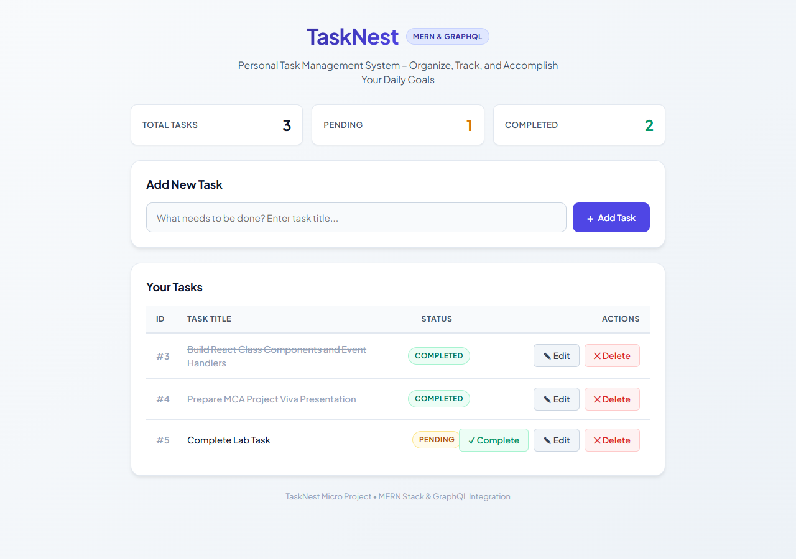
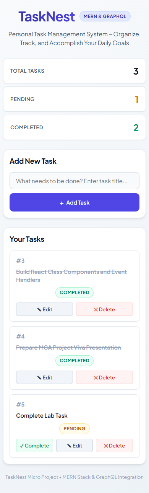
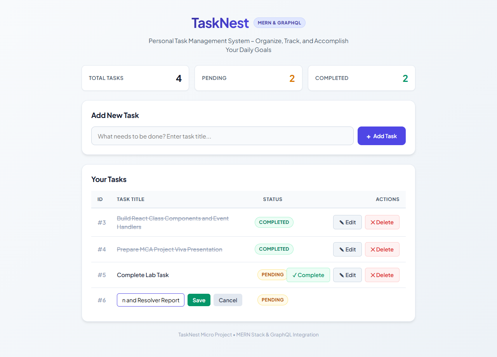
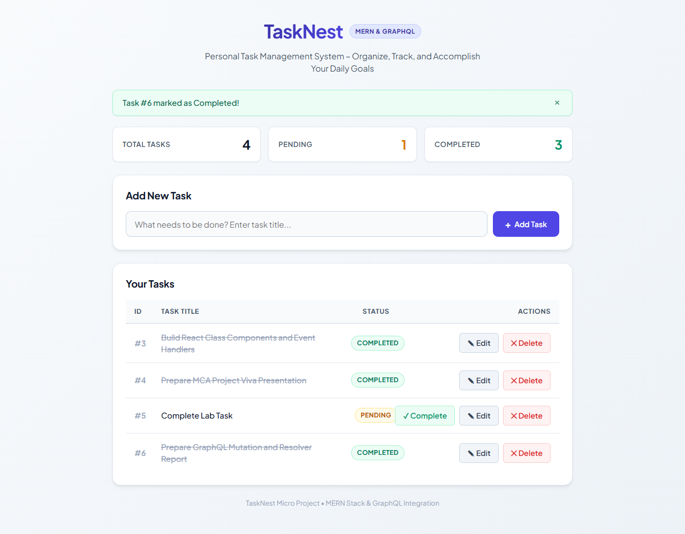

# TaskNest – Personal Task Management System

[](https://www.mongodb.com/mern-stack)
[](https://graphql.org/)
[](https://react.dev/)
[](https://nodejs.org/)
[](LICENSE)

TaskNest is a full-stack personal task management application built with the **MERN Stack** (MongoDB, Express.js, React.js, Node.js) and a **GraphQL API**. It was designed as an academic micro project demonstrating React Class Components, lifecycle methods, Lifting State Up, and native Fetch API communication with GraphQL.

---

## 📸 Screenshots

| Desktop View | Mobile Responsive View |
| :---: | :---: |
|  |  |

| Inline Editing | Task Completion |
| :---: | :---: |
|  |  |

---

## ✨ Features

- **Add Task:** Create a new task with real-time input validation.
- **Display Tasks:** View tasks with custom status badges (`Pending` or `Completed`).
- **Inline Editing:** Edit task titles inline with Save and Cancel actions.
- **Mark Complete:** Toggle task status to `Completed` with visual strike-through styling.
- **Delete Task:** Remove tasks with confirmation dialogs.
- **Summary Counters:** Real-time stats bar showing Total, Pending, and Completed tasks.
- **Fully Responsive:** Adapts cleanly from desktop tables to mobile card layouts.
- **Pure Native Fetch API:** Communicates with the GraphQL endpoint without third-party client bloat.

---

## 🛠️ Technology Stack

| Layer | Technology | Purpose |
|---|---|---|
| **Frontend** | React 18 | Class components (`constructor`, `this.state`, `this.setState`, `componentDidMount`) |
| **Build Tool** | Vite 6 | Development server with reverse-proxy support |
| **Styling** | Vanilla CSS3 | Custom design system, CSS flexbox/grid, and media queries |
| **Backend** | Node.js & Express | CommonJS server architecture |
| **API** | GraphQL & Apollo Server 4 | Single `/graphql` endpoint for queries and mutations |
| **Database** | MongoDB & Mongoose 8 | Document persistence with integer ID sequence |
| **Networking** | JavaScript Fetch API | Native browser HTTP POST requests |

---

## 📁 Project Structure

```
TaskNet-mern/
│
├── client/                     # React frontend (Vite)
│   ├── src/
│   │   ├── components/
│   │   │   ├── TaskList.jsx    # Stateful parent: holds state & handles GraphQL calls
│   │   │   ├── TaskAdd.jsx     # Stateful form: adds new tasks
│   │   │   ├── TaskTable.jsx   # Stateless table: displays task collection
│   │   │   └── TaskRow.jsx     # Stateful row: inline edit & action triggers
│   │   ├── App.jsx             # Root component
│   │   ├── index.js            # Entry point initializing DOM root
│   │   └── App.css             # Complete responsive styling
│   └── vite.config.js          # Development server and proxy settings
│
├── server/                     # Node.js + Express backend
│   ├── models/
│   │   └── Task.js             # Mongoose task schema (id, title, status)
│   ├── schema/
│   │   ├── typeDefs.js         # GraphQL type definitions
│   │   └── resolvers.js        # GraphQL Query & Mutation resolvers
│   └── server.js               # Express application and Apollo Server setup
│
├── docs/screenshots/           # High-resolution screenshots
├── PROJECT_DOCUMENTATION.md    # Comprehensive academic report
├── PROJECT_EXPLANATION.md      # Detailed viva preparation guide
├── package.json                # Root scripts orchestration
└── LICENSE                     # MIT License
```

---

## 🚀 Getting Started

### Prerequisites

- [Node.js](https://nodejs.org/) (v18 or higher)
- [MongoDB Community Server](https://www.mongodb.com/try/download/community) running locally on port `27017`

### 1. Clone the Repository

```bash
git clone https://github.com/hanson0704/TaskNest-.git
cd TaskNest-
```

### 2. Install Dependencies

Install all dependencies for root, server, and client:

```bash
npm run install-all
```

*(Or individually: `cd server && npm install`, then `cd ../client && npm install`)*

### 3. Ensure MongoDB is Running

```powershell
net start MongoDB
```

### 4. Start the Application

Open two terminal windows:

**Terminal 1 — Backend Server:**
```bash
npm run server
```
*Backend runs at `http://localhost:5000` (GraphQL endpoint at `/graphql`)*

**Terminal 2 — Frontend Client:**
```bash
npm run client
```
*Frontend runs at `http://localhost:3000`*

Open your browser and navigate to:
👉 **`http://localhost:3000`**

---

## 📡 GraphQL Operations Overview

### Query
- `taskList`: Retrieves all tasks sorted by `id`.

### Mutations
- `addTask(title: String!)`: Creates a new pending task.
- `updateTask(id: Int!, title: String!)`: Updates a task's title.
- `updateTaskStatus(id: Int!, status: String!)`: Updates status to `Completed`.
- `deleteTask(id: Int!)`: Permanently removes a task.

---

## 📖 Documentation

- **[PROJECT_DOCUMENTATION.md](PROJECT_DOCUMENTATION.md):** 19-section formal academic documentation with detailed component breakdowns, architecture diagrams, and verified screenshots.
- **[PROJECT_EXPLANATION.md](PROJECT_EXPLANATION.md):** 25-section project defense guide with viva preparation cheat-sheets.

---

## 📄 License

This project is licensed under the MIT License — see the [LICENSE](LICENSE) file for details.
